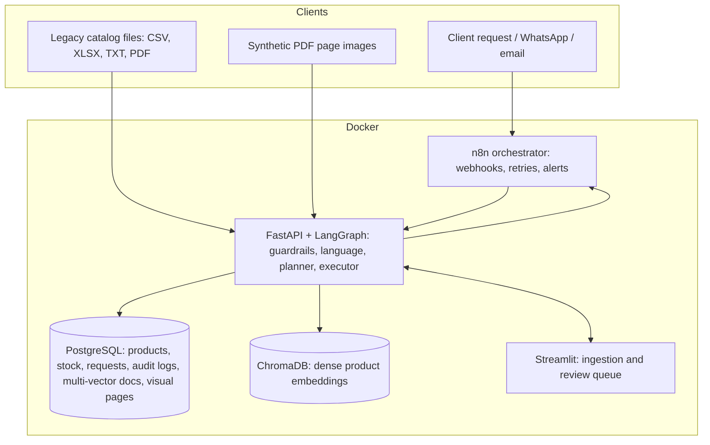
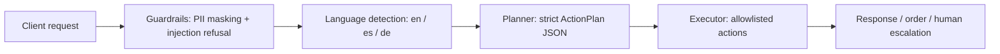
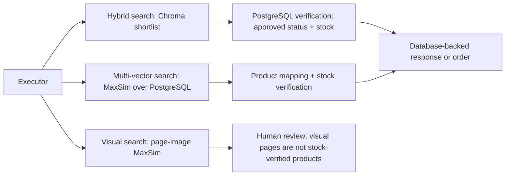
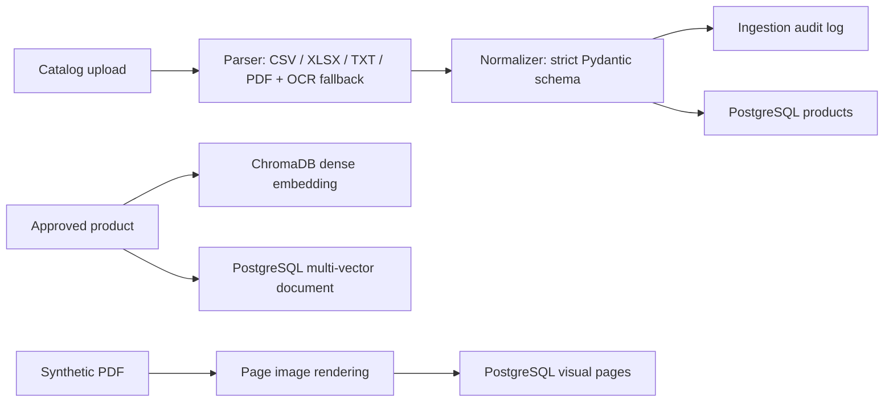
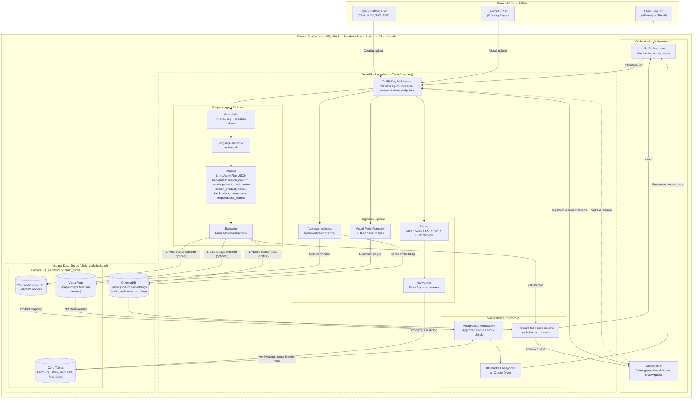

# MedSupplyFlow-AI Architecture

## High-Level System

## Request Agent Flow

## Retrieval and Verification

## Ingestion Flow

## Trust Boundaries and Isolation

- `X-API-Key` middleware protects ingestion, agent, client-request, review, and visual ingestion endpoints.
- Clinic isolation is enforced by `clinic_code` in PostgreSQL, Chroma metadata filters, `MultiVectorDocument`, and `VisualPage`.
- The planner only returns allowlisted actions: `search_product`, `search_product_multi_vector`, `search_product_visual`, `check_stock`, `create_order`, `respond`, `ask_human`.
- The executor verifies product status and stock before creating an order.
- Visual page matches are explicitly escalated to human review because they are not automatically mapped to stock-verified products.
- Multi-vector and visual retrieval are optional advanced paths; Chroma remains the fast dense shortlist.
- PostgreSQL and ChromaDB are internal services; the API, n8n, and UI are localhost-bound in the demo.

## Full Architecture Diagram Source

The following Mermaid source generates `mermaid-diagram-full.png`:

