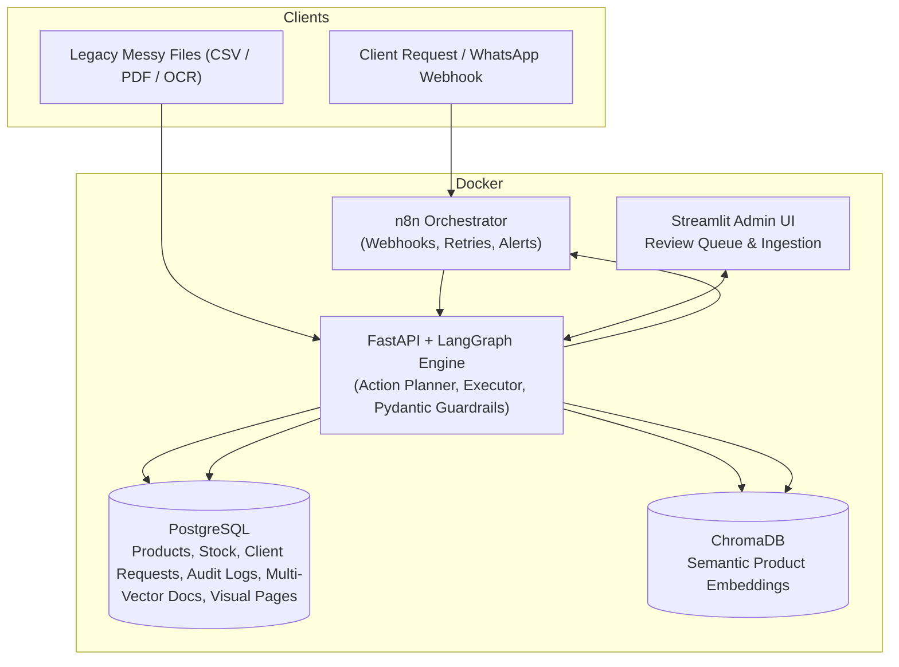

# MedSupplyFlow-AI

[](https://github.com/adiljouahri/medsupplyflow-AI-RAG/actions)


An open-source, Dockerized AI automation platform that ingests messy legacy surgical catalogs into PostgreSQL + ChromaDB and automates synthetic client product requests through n8n and LangGraph. It uses an action-based agent flow, multilingual detection, clinic isolation via metadata filters, and GDPR/PII guardrails.

> **Data rule:** this repository contains only synthetic demo products and fake clinic names. No real clinic names, supplier price lists, or patient data are included.

> **Showcase disclaimer:** this is a synthetic engineering demo, not clinical software, a medical device, or a production healthcare system.

---

## ⚡ 60-Second Quickstart

Spin up the entire stack (PostgreSQL, ChromaDB, FastAPI API, LangGraph agent, n8n, and Streamlit Admin UI) with one command:

```bash
cp .env.example .env
docker compose up --build
```

### Active Local Services & Endpoints

| Service | URL | Description |
|---|---|---|
| **Streamlit Admin UI** | [http://localhost:8501](http://localhost:8501) | Catalog upload, review queue, and human approval workflow |
| **FastAPI Engine & Swagger** | [http://localhost:8000/docs](http://localhost:8000/docs) | Interactive API documentation, guardrail testing, and agent execution |
| **n8n Orchestrator** | [http://localhost:5678](http://localhost:5678) | Webhook triggers, WhatsApp / email automation, and alerts (`demo-user` / `demo-password`) |
| **API Healthcheck** | [http://localhost:8000/health](http://localhost:8000/health) | System health & status check |

---

## Architecture




The rendered full architecture diagram is above; its Mermaid source is in [ARCHITECTURE.md](ARCHITECTURE.md).

## Action-Based Agent Flow

The agent does not use one separate agent per tool. The planner returns a strict JSON action list (`search_product`, `search_product_multi_vector`, `search_product_visual`, `check_stock`, `create_order`, `respond`, `ask_human`). The `ActionPlan` schema validates the allowlist, and the executor runs only those actions against PostgreSQL and ChromaDB. Unknown actions, missing clinic codes, and low-confidence actions are rejected or escalated.

## Key Engineering Trade-offs

- **ActionPlan allowlist instead of autonomous agent loops:** deterministic, auditable tool execution; unknown actions are rejected before execution.
- **Hybrid Chroma + PostgreSQL:** Chroma supplies a fast semantic shortlist, while PostgreSQL verifies approved status, stock, and order integrity.
- **Optional ML dependency groups:** the core API stays lean; advanced Sentence Transformers/multimodal retrieval is opt-in via `.[advanced]`.
- **Sync ingestion endpoints:** `/ingest` and `/ingest/visual` use FastAPI's threadpool rather than blocking the async event loop during parsing and model work.

## AI Provider Choice

The code uses **LiteLLM**, so you can switch providers without changing the application:

- **OpenAI:** `openai/gpt-4o-mini`
- **Gemini:** `gemini/gemini-1.5-flash`
- **Local Ollama:** `ollama/llama3.2`

Set `LLM_MODEL` and `LLM_API_KEY` in `.env`. For local Ollama, run Ollama on the host and use the default `OLLAMA_BASE_URL` of `http://host.docker.internal:11434`. The request agent uses a deterministic fallback planner when no LLM key is configured; the LLM planner is optional. The tests use a mock LLM, so CI does not need a paid API key.

## Advanced Sentence Transformers v6.0 Retrieval

The project now includes an optional advanced retrieval layer built on Sentence Transformers v6.0:

- `MultiVectorEncoder` stores one vector per token and scores with MaxSim.
- `MultiVectorDocument` stores synthetic product document token vectors in PostgreSQL.
- `VisualPage` stores synthetic PDF page images and visual token vectors for OCR-free retrieval.
- `/ingest/visual` renders PDF pages and stores page-image embeddings.
- `multi_vector_search` and `visual_search` expose the advanced retrieval tools.
- `search_product_visual` is allowlisted but escalates to human review because visual pages are not mapped to stock-verified products.

This does **not** replace the ChromaDB dense path. Chroma remains the fast semantic shortlist, PostgreSQL verifies approved status and stock, and advanced retrieval is an optional rerank path. The demo stores multi-vector and visual records in PostgreSQL to avoid adding a new vector-database service; production deployments should use a dedicated multi-vector store such as Qdrant or FAISS and pin model revisions.

Model weights are downloaded at runtime. For reproducible offline builds, pre-download the models or mount a Hugging Face cache. The visual model is large and requires the optional `sentence-transformers[image]` extra. Install advanced retrieval extras with `pip install -e ".[advanced]"`; the Docker image installs core dependencies by default, so advanced endpoints fail gracefully unless the extra is installed.

Local install options:

```bash
pip install -e .
pip install -e ".[advanced]"   # Sentence Transformers multimodal extras
pip install -e ".[ui]"         # Streamlit UI
pip install -e ".[eval]"       # optional DeepEval
```

For a Docker build with advanced extras:

```bash
docker build --build-arg ADVANCED_DEPS=1 -t medsupplyflow-ai .
```

## Production Roadmap

- **Alembic migrations:** replace `Base.metadata.create_all()` / `init.sql` duplication with versioned migrations for production deployments.
- **Observability:** structured request IDs, tracing, metrics, and review audit correlation.
- **Background ingestion:** move large catalog and visual ingestion into a queue/worker pattern.
- **Dedicated multi-vector store:** use Qdrant/FAISS or a managed vector service for production-scale multi-vector retrieval.
- **Hardened deployment:** OAuth/JWT identity, authorization, rate limiting, TLS, and secrets management.
- **UI improvements:** pagination, stricter input validation, and richer review workflow.

## Repository Layout

```text
MedSupplyFlow-AI/
├── .github/workflows/ci.yml
├── app/
│   ├── main.py
│   ├── config.py
│   ├── db/
│   │   ├── models.py
│   │   ├── session.py
│   │   ├── vector_store.py
│   │   ├── multi_vector_store.py
│   │   ├── visual_store.py
│   │   └── init.sql
│   ├── ingestion/
│   │   ├── parser.py
│   │   ├── visual_parser.py
│   │   ├── normalizer.py
│   │   └── schemas.py
│   └── agent/
│       ├── action_schema.py
│       ├── executor.py
│       ├── language.py
│       ├── planner.py
│       ├── guardrails.py
│       ├── graph.py
│       └── tools.py
├── n8n/
│   ├── workflows/
│   │   ├── client_request_flow.json
│   │   ├── whatsapp_request_flow.json
│   │   ├── email_notification_flow.json
│   │   └── error_handler_flow.json
│   └── README.md
├── sample_data/
│   ├── messy_legacy_surgical_catalog.csv
│   ├── clinic_metadata.json
│   └── sample_client_requests.json
├── tests/
│   ├── test_ingestion.py
│   ├── test_guardrails.py
│   ├── test_agent_api.py
│   ├── test_action_schema.py
│   ├── test_language.py
│   ├── test_fallback_plan.py
│   ├── test_clinic_isolation.py
│   ├── test_multi_vector.py
│   ├── test_visual_parser.py
│   └── test_deepeval.py
├── ui/
│   ├── Dockerfile
│   └── streamlit_app.py
├── Dockerfile
├── docker-compose.yml
├── .env.example
├── .dockerignore
├── pyproject.toml
├── LICENSE
├── SECURITY.md
├── mermaid-diagram-full.png
├── ARCHITECTURE.md
└── README.md
```

## Core Features

1. **Messy catalog ingestion:** CSV, Excel, text, and scanned PDF support; OCR fallback via PyMuPDF + pytesseract.
2. **Strict Pydantic v2 normalization:** required `sku`, `canonical_name`, `category`, `sterile_type`, `unit_of_measure`, `package_qty`, stock, and confidence score.
3. **Clinic isolation:** three synthetic clinics (`demo-clinic-a`, `demo-clinic-b`, `demo-clinic-c`) are stored in PostgreSQL and used as Chroma metadata filters.
4. **Deduplication:** exact SKU plus fuzzy canonical-name matching updates existing products instead of duplicating them.
5. **Human-in-the-loop safety:** confidence below `0.85` is staged as `needs_review`; reviewers can approve or reject.
6. **Hybrid retrieval:** Chroma finds candidates; PostgreSQL verifies approved status and available stock.
7. **Action-based agent:** the planner returns a strict JSON action list; the executor runs only validated, allowlisted actions.
8. **Multilingual requests:** language detection for `en`, `es`, and `de`; unsupported languages escalate to human review.
9. **n8n orchestration:** webhook → FastAPI agent → human alert or confirmation, plus a synthetic WhatsApp and email flow.
10. **Tests and CI:** mock LLM tests, action/language validation, ruff, and pytest CI checks; Docker compose verification is manual.
11. **Advanced Sentence Transformers v6.0 retrieval:** PostgreSQL-backed `MultiVectorDocument` records for ColBERT-style MaxSim scoring, plus `VisualPage` records for OCR-free page-image retrieval.

## Security & Compliance Controls

| Control | Implementation | Why it matters |
|---|---|---|
| Synthetic-only data | `sample_data/` contains fake clinics, products, and stock numbers | Avoids real clinic/patient/supplier exposure in a public repo |
| API key protection | `X-API-Key` middleware protects ingestion, agent, client-request, and review endpoints | Prevents unauthenticated data access or mutation |
| Demo-level auth | `X-API-Key` is a shared secret, not user identity or role-based authorization | Production needs OAuth/JWT, permissions, and audit identity |
| Non-root containers | API and UI images run as `appuser` | Reduces container compromise impact |
| Upload limit | `MAX_UPLOAD_MB` and `MAX_ROWS` limit file size and catalog rows | Limits memory/DoS and LLM-call abuse |
| Strict schema validation | Pydantic v2 `extra="forbid"` on catalog and request payloads | Rejects corrupted or over-broad input |
| Human review queue | Confidence below `0.85` is marked `needs_review` | AI errors do not auto-publish in a surgery context |
| Hybrid retrieval | Chroma candidates are verified against PostgreSQL status and stock | Prevents invented products or availability claims |
| Clinic isolation | `Product.clinic_code` plus Chroma `where={"clinic_code": ...}` and SQL filtering | Prevents cross-clinic product leakage |
| Advanced retrieval isolation | `MultiVectorDocument.clinic_code` and `VisualPage.clinic_code` filters | Prevents cross-clinic leakage in multi-vector and visual retrieval |
| Model supply chain | `sentence-transformers[image]==6.0.0` and fixed model names | Reduces untrusted model substitution; production should pin revisions |
| Visual page storage | Synthetic PDF pages are stored as `BYTEA` in PostgreSQL | Avoids real patient/clinic page leakage in the showcase |
| Language fallback | `langdetect` supports only `en`, `es`, and `de`; unknown languages escalate | Avoids unsafe or untranslated replies |
| Action allowlist | Planner output is validated by `ActionPlan`; unknown actions are rejected | Prevents arbitrary tool selection |
| PII masking | Phones, emails, and identifiers are masked before agent use | Reduces GDPR exposure; masked text is what is stored |
| Prompt-injection refusal | Heuristic pattern check escalates suspicious requests | Blocks common prompt-injection attempts, but is not a complete security control |
| Audit logging | Ingestion actions and failures are logged | Supports traceability and review |
| Port exposure | PostgreSQL and ChromaDB are not published to the host; API/n8n/UI bind to `127.0.0.1` | Keeps the local showcase from exposing backing services |
| Demo secrets | Compose and `.env.example` use placeholder values only | No real credentials should be committed |
| Pinned demo images | Chroma `1.5.10.dev326` and n8n `1.123.100` are explicit tags | Avoids `latest` drift; verify approved production tags |

**Important:** the guardrails are heuristic. For a real healthcare deployment, add authentication, authorization, rate limiting, TLS, secrets management, audit review, and legal/compliance review. See [SECURITY.md](SECURITY.md).

## API & Ingestion Examples

Ingestion:

```bash
curl -X POST http://localhost:8000/ingest \
  -H "X-API-Key: demo-internal-api-key" \
  -F "file=@sample_data/messy_legacy_surgical_catalog.csv" \
  -F "source_label=synthetic legacy catalog" \
  -F "clinic_code=demo-clinic-a"
```

Client request:

```bash
curl -X POST http://localhost:8000/agent/request \
  -H "X-API-Key: demo-internal-api-key" \
  -H "Content-Type: application/json" \
  -d '{"client_name":"Demo Clinic A","clinic_name":"Demo Clinic A","clinic_code":"demo-clinic-a","request_text":"Send 10 boxes of #15 scalpels to Demo Clinic A by Friday"}'
```

Multilingual synthetic request:

```bash
curl -X POST http://localhost:8000/agent/request \
  -H "X-API-Key: demo-internal-api-key" \
  -H "Content-Type: application/json" \
  -d '{"client_name":"Demo Clinic B","clinic_name":"Demo Clinic B","clinic_code":"demo-clinic-b","request_text":"Enviando 5 unidades de producto para Demo Clinic B antes 2026-06-30"}'
```


Review queue:

```bash
curl http://localhost:8000/review/queue \
  -H "X-API-Key: demo-internal-api-key"
```

## Safety Notes

- The agent never invents products or prices; it only returns rows from PostgreSQL.
- Clinic isolation prevents cross-clinic product retrieval through Chroma and SQL filters.
- The planner returns only allowlisted actions; unknown actions are rejected.
- PII is masked before the LLM or agent path.
- Prompt-injection patterns trigger human escalation.
- Unsupported languages trigger human escalation.
- Every low-confidence catalog item is held for review rather than auto-published.
- Orders that exceed stock or lack an approved match require human review.
- Planner failures and invalid action lists fall back to human review.
- The n8n error handler records failed calls so requests are not silently lost.

## Public GitHub Checklist

Before publishing:

- Keep `.env` untracked; it is already in `.gitignore`.
- Do not commit real clinic names, supplier prices, patient IDs, or request logs.
- Use only the synthetic clinic codes `demo-clinic-a`, `demo-clinic-b`, and `demo-clinic-c`.
- Replace demo API keys and passwords before any real deployment.
- Pinned demo tags are set for Chroma and n8n; replace them with approved production releases.
- Put the API behind HTTPS/reverse proxy and require real authentication.
- Keep PostgreSQL and ChromaDB private; only the API should be exposed.
- Review the action allowlist and language support before adding new tools.
- Treat the WhatsApp and email workflows as synthetic templates, not production integrations.
- Do not commit Hugging Face model caches or real PDFs; use synthetic PDF pages only.
- Pin Sentence Transformers and model revisions, and replace demo model names before production.
- Review the heuristic guardrails against your actual GDPR/security requirements.
- Use the human review queue for anything below the confidence threshold.

## Known Limitations

- The n8n workflow files are starter exports; verify them after importing into n8n.
- The WhatsApp and email flows are synthetic templates, not production integrations.
- OCR needs the system `tesseract` binary; the Dockerfile installs it.
- Prompt-injection and PII checks are pattern-based, not a complete security boundary.
- The agent can still misinterpret ambiguous requests; human escalation is intentional.
- The LLM planner is optional. Without `LLM_API_KEY`, the deterministic fallback planner is used.
- The planner can fail or return invalid JSON; that escalates to human review.
- Language detection covers only `en`, `es`, and `de`; more languages need explicit support.
- The admin UI is optional and should not be treated as the production auth layer.
- The n8n exports still contain a demo `X-API-Key`; replace it before importing into a real environment.
- The pinned Chroma tag is a current demo tag, not a guaranteed production release.
- Multi-vector and visual retrieval increase storage and model-download cost; the PostgreSQL-backed demo store is not a production multi-vector database.
- Visual retrieval requires a configured visual model and synthetic PDF pages; it is not a validated OCR-free production pipeline.
- No rate limiting, TLS, or secrets manager is implemented; use a reverse proxy and real identity/authorization in production.
- The DeepEval test is optional and requires a model API key; it is not a complete evaluation suite.

## Tests

The test suite mocks the LLM and does not require a paid API key:

```bash
ruff check .
pytest -q
```

It covers ingestion, guardrails, request schemas, action validation, language detection, the deterministic fallback planner, the clinic-filtered search signature, the v6.0 multi-vector and visual actions, and the visual parser entry point. The optional DeepEval test is skipped unless `DEEPEVAL_API_KEY` is set. The GitHub Actions workflow runs the checks and a Docker build check on push.

## AI Evaluation with DeepEval

DeepEval is a unit-testing framework for LLM applications: [https://github.com/confident-ai/deepeval](https://github.com/confident-ai/deepeval). Its evaluation-prompt guide is here: [https://deepeval.com/docs/evaluation-prompts](https://deepeval.com/docs/evaluation-prompts).

The optional test `tests/test_deepeval.py` uses DeepEval's `AnswerCorrectness` metric to evaluate synthetic AI answers. DeepEval is included in `pyproject.toml`. It requires `DEEPEVAL_API_KEY`; without that key, `pytest` skips the test instead of failing CI.

Run it only after you authorize execution:

```bash
DEEPEVAL_API_KEY=your-key \
DEEPEVAL_MODEL=gpt-4o-mini \
pytest -q tests/test_deepeval.py
```

## Verification & Smoke Tests

To verify the stack locally:

```bash
python -m venv .venv
pip install -e .
pip install ruff
ruff check .
pytest -q
docker compose build
docker compose up -d
```

Smoke checks:

```bash
curl -fsS http://localhost:8000/health
curl -fsS -H "X-API-Key: demo-internal-api-key" \
  http://localhost:8000/review/queue
curl -fsS -X POST http://localhost:8000/ingest \
  -H "X-API-Key: demo-internal-api-key" \
  -F "file=@sample_data/messy_legacy_surgical_catalog.csv" \
  -F "clinic_code=demo-clinic-a"
curl -fsS -X POST http://localhost:8000/agent/request \
  -H "X-API-Key: demo-internal-api-key" \
  -H "Content-Type: application/json" \
  -d '{"client_name":"Demo Clinic A","clinic_name":"Demo Clinic A","clinic_code":"demo-clinic-a","request_text":"Send 5 units by 2026-06-30"}'
curl -fsS -X POST http://localhost:8000/agent/request \
  -H "X-API-Key: demo-internal-api-key" \
  -H "Content-Type: application/json" \
  -d '{"client_name":"Demo Clinic B","clinic_name":"Demo Clinic B","clinic_code":"demo-clinic-b","request_text":"Enviando 5 unidades de producto para Demo Clinic B antes 2026-06-30"}'

# Optional advanced visual ingestion after adding a synthetic PDF:
curl -fsS -X POST http://localhost:8000/ingest/visual \
  -H "X-API-Key: demo-internal-api-key" \
  -F "file=@sample_data/synthetic_catalog.pdf" \
  -F "clinic_code=demo-clinic-a"
```

Inspect failures and stop the stack:

```bash
docker compose logs api
docker compose down
```

Expected checks:

- `ruff` and `pytest` pass.
- `/health` returns `{"status":"ok",...}`.
- `/review/queue` returns a review list with clinic codes and the API key.
- Ingestion returns `clinic_code`, parsed-row counts, and insert/update counts.
- The agent request returns `needs_human` or a database-backed order.
- The multilingual request returns a detected language such as `es`, or escalates cleanly.
- `/client/requests` shows the stored clinic code and masked request text.
- Approving a product returns `multi_vector_indexed`; it is `false` if the advanced model or cache is unavailable.
- `/ingest/visual` returns `pages_stored` when a synthetic PDF and visual model cache are available.
- `docker compose logs api` shows no startup or DB connection errors.
